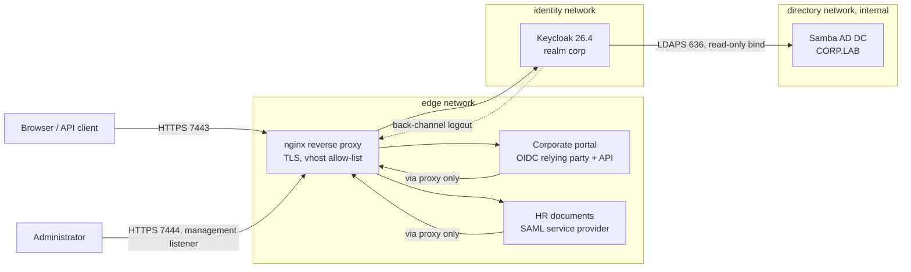

# IAM Integration Lab

**Active Directory → Keycloak → applications, integrated end to end and tested like a delivery.**

A reproducible lab that federates a Samba Active Directory domain into Keycloak, puts one
OpenID Connect app and one SAML 2.0 app behind single sign-on, enforces MFA for
administrators, runs joiner / mover / leaver from AD, segments the network, and detects
identity attacks by correlating Keycloak events with the domain controller's audit.
**45 automated tests** check each behaviour, including the attacks that should fail.

> Provenance: based on my January–February 2026 lab work on Active Directory, LDAP and
> SSO protocols. Rebuilt as one reproducible repository and published in November 2026.
> Everything here is synthetic. It is a lab, not a production deployment (see [Limits](#limits)).

## Architecture



| Component | Role | Key settings |
|---|---|---|
| Samba 4.17 AD DC | Source of truth: OUs, users, security groups | LDAPS with a lab CA, plaintext simple bind refused, JSON authentication audit |
| Keycloak 26.4 | Identity provider, LDAP federation | Read-only AD federation, AD groups → Keycloak groups → roles, brute-force protection |
| Portal (Flask) | OIDC relying party + REST API | Authorization Code + PKCE S256, local JWT validation, back-channel logout |
| HR documents (Flask + pysaml2) | SAML 2.0 service provider | Signed Response **and** Assertion required, no unsolicited responses, replay refused |
| nginx | Single entry point | TLS 1.2+, admin console only on a separate management listener, unknown hosts dropped |

## What it covers

**Directory and federation**
- AD domain `CORP.LAB` with `OU=Staff`, `OU=Groups`, `OU=Service`. The Keycloak bind
  account is an ordinary user in its own OU: it can read the directory, nothing more.
- LDAPS only, with certificate validation. A plaintext bind gets
  `Strong(er) authentication required`.
- Federation is `READ_ONLY` with no cache, so AD changes apply at the next login.
  Group mapping uses `member` / `memberOf`, and the MSAD account-control mapper is on.

**SSO and access control**
- OIDC: confidential client, Authorization Code + **PKCE S256 mandatory**, exact redirect
  URI, password grant disabled, `groups` claim, audience mapper.
- API: the token is checked locally (RS256 pinned, signature against JWKS, `iss`, `aud`, `exp`).
- SAML 2.0: RSA-SHA256 signatures on Response and Assertion. Only `email` and `groups`
  are released: the default role list is removed.
- Authorization comes from AD groups: `Finance`, `HR`, `IT-Admins`.

**Privileged access**
- Members of `IT-Admins` get the realm role `corp-admin`. A custom browser flow requires
  TOTP for that role. Admins are forced to enrol at first login, so they can't skip MFA
  by simply never configuring it.

**Lifecycle (joiner / mover / leaver)**
- [`scripts/lifecycle.py`](scripts/lifecycle.py) works on AD only; Keycloak follows.
- The leaver procedure has two steps:
  1. Disable the AD account.
  2. Revoke every Keycloak session one by one and verify none is left.

  The second step triggers back-channel logout in the applications.

**Network**
- Three Docker networks. The applications can't reach the directory or Keycloak directly.
  The directory network is `internal`, and no directory port is published.
- The admin console is blocked on the public listener (`/admin`, `/realms/master` → 403)
  and served on a separate management listener. Both listeners bind to 127.0.0.1, so
  nothing is exposed to the local network.

**Monitoring**
- Keycloak login and admin events, plus the DC's JSON authentication audit (Windows
  event IDs 4624/4625 with NT status).
- [`scripts/detect.py`](scripts/detect.py) runs five rules, with output as text or JSON lines ready for a SIEM:

| Rule | Detects | Sources |
|---|---|---|
| `KC-BRUTE` | ≥ 5 failed SSO login attempts on one account in 10 min, including attempts while locked | Keycloak |
| `KC-LOCKED` | Attempts on an account locked by brute-force protection | Keycloak |
| `AD-DISABLED` | A disabled account (leaver) trying to sign in, correlated with the SSO failure it caused | DC audit + Keycloak |
| `AD-SPRAY` | Wrong passwords on ≥ 3 accounts in 5 min | DC audit |
| `KC-PRIV` | Admin-plane changes: role mappings, clients, flows, users | Keycloak admin events |

```text
$ scripts/detect.py --minutes 2 --no-info
2026-11-20T10:24:37Z  medium AD-DISABLED  daveb56d44   disabled AD account tried to sign in through SSO
2026-11-20T10:25:50Z  high   KC-LOCKED    bob          8 login attempt(s) on an account locked by brute-force protection
2026-11-20T10:26:02Z  high   KC-BRUTE     bob          14 failed SSO login attempts in 77s
2026-11-20T10:26:02Z  high   AD-SPRAY     alice,bob,carol wrong passwords on 3 accounts within 5 minutes
```

## Use cases and tests

Each use case is a pytest module that drives a scripted browser through the real login
pages. The test results are recorded in [docs/test-report.txt](docs/test-report.txt).

| # | Use case | Crosses | Tests |
|---|---|---|---|
| 1 | Segmentation, LDAPS, exposed surface | network × identity | [test_01_network.py](tests/test_01_network.py) (8) |
| 2 | AD group → application access via OIDC SSO, protocol hardening | identity × apps | [test_02_oidc_sso.py](tests/test_02_oidc_sso.py) (8) |
| 3 | Forged and misdirected tokens: `alg:none`, edited payload, attacker key, HS256 key confusion, wrong audience | security × apps | [test_03_tokens.py](tests/test_03_tokens.py) (8) |
| 4 | MFA enforced by role, forced enrolment | identity × security | [test_04_mfa.py](tests/test_04_mfa.py) (4) |
| 5 | Joiner / mover / leaver, session revocation | identity × systems | [test_05_lifecycle.py](tests/test_05_lifecycle.py) (4) |
| 6 | Brute force, spraying, leaver sign-in, privilege change detection | identity × monitoring | [test_06_bruteforce_detection.py](tests/test_06_bruteforce_detection.py) (4) |
| 7 | SAML: signed assertions, attribute tampering, NameID swap, replay, stolen and unsolicited responses | federation × security | [test_07_saml.py](tests/test_07_saml.py) (9) |

## Run it

Requirements: Docker with Compose v2, Python 3.10+, OpenSSL, and about 2 GB of free RAM (about 1.1 GB measured).
`*.localtest.me` is public DNS that resolves to 127.0.0.1.

```bash
bash scripts/setup.sh          # certificates, secrets, containers, AD seed, Keycloak config
.venv/bin/python -m pytest -c tests/pytest.ini tests -v
```

| URL | What |
|---|---|
| https://portal.localtest.me:7443 | OIDC portal: `/finance`, `/hr`, `/admin`, `/api/me` |
| https://saml.localtest.me:7443 | SAML app: `/finance-documents`, `/hr-documents` |
| https://sso-admin.localtest.me:7444/admin/ | Keycloak admin console (credentials in `.env`) |

Users: `alice` (Finance), `bob` (HR), `carol` (IT-Admins, MFA). The shared lab password
is `AD_USER_PASSWORD` in `.env`. Your browser will warn about the certificate unless you
import `certs/ca.pem`.

Operations:

```bash
.venv/bin/python scripts/lifecycle.py joiner dave Finance
.venv/bin/python scripts/lifecycle.py mover dave Finance HR
.venv/bin/python scripts/lifecycle.py leaver dave
.venv/bin/python scripts/detect.py --minutes 30 --json
docker compose down -v         # remove everything
```

## Findings from building it

These came up during the build and are written down because they matter in real
deployments. The runbook is in [docs/troubleshooting.md](docs/troubleshooting.md).

1. **Disabling an AD account doesn't end open sessions.** New logins fail right away, but
   a session opened before stays usable. That's why the leaver procedure has a revocation
   step, and why a test proves the gap exists without it.
2. **The bulk "log out user" call didn't reach every session.** On Keycloak 26.4,
   `POST /users/{id}/logout` sent a single back-channel logout for a user with three
   sessions, so two stayed open in the application. Revoking each session separately
   sends one logout token per session. The leaver now does that and checks that zero remain.
3. **Keycloak can't tell a leaver from a typo.** Both show up as `invalid_user_credentials`,
   because Keycloak only sees a failed LDAP bind. The DC audit has the real reason
   (`4625 NT_STATUS_ACCOUNT_DISABLED`), so `AD-DISABLED` correlates the two sources.
   The login page stays generic on purpose, so it doesn't disclose account state.
4. **Already-issued access tokens survive revocation** until they expire, because they are
   stateless JWTs checked locally. This is limited to 5 minutes here, and the test makes
   the residual risk explicit.
5. **The default SAML client scopes released every internal role name.** I removed them so the
   app receives exactly `email` and `groups`.
6. **Brute-force protection includes a "quick login" check.** Two failures less than one
   second apart lock the account for a minute. This first surfaced as a flaky MFA test.
   On a fresh install it also exposed a gap in my own rule: after the lock, attempts are
   logged as `user_temporarily_disabled`, so counting only wrong passwords let a fast
   attacker stay under the threshold. `KC-BRUTE` now counts both.
7. **Samba keeps the SYSVOL ACLs in `security.*` extended attributes.** The DC container
   gets `SYS_ADMIN` and nothing else (not `privileged`). Its `smb.conf` now lives in the
   data volume, after a rebuild showed the domain would not start without it.
8. **Keycloak 26.4 renamed the default 2FA sub-flow** and added a credential condition. The
   configuration script finds the sub-flow by its structure rather than a fixed name.

## Security decisions

- AD is authoritative, and Keycloak federation is read-only: no write path back to the directory.
- Least privilege for the integration: a non-admin bind account, no Kerberos delegation,
  and secrets generated per install in a git-ignored `.env`.
- No implicit flow and no password grant. PKCE is required even for the confidential client.
- Tokens: access 5 min, SSO idle 30 min, max 8 h, refresh tokens rotate and can't be reused.
- The application checks group membership itself instead of trusting that the IdP only lets
  the right users through. Redirect targets after login are restricted to local paths.

## Limits

- Lab grade: Keycloak runs `start-dev` with its embedded database, the CA is private, and
  everything is on one host.
- The portal keeps back-channel revocations in process memory (one worker).
  A real deployment would use a shared store.
- Network segmentation uses Docker networks and a reverse proxy, not a firewall appliance.
- Detections run as a script. The JSON output is meant for a SIEM (Wazuh/ELK), but log
  shipping isn't included.
- Not covered: Kerberos/SPNEGO desktop SSO, PAM/vaulting, SCIM provisioning,
  WebAuthn/passkeys, high availability.

## Product equivalents

| Here | Typical enterprise counterpart |
|---|---|
| Samba AD DC | Microsoft Active Directory, Entra ID Connect for hybrid |
| Keycloak | Entra ID, Okta, Ping, or Keycloak itself |
| Role-based MFA flow | Conditional Access policy |
| Leaver session revocation | "Revoke sessions" / sign-in session revocation |
| nginx listener separation | Reverse proxy / WAF, admin plane on a management network |
| `detect.py` rules | SIEM correlation rules on IdP + DC logs |

## Repository layout

```text
docker-compose.yml            five services, three networks
dc/                           Samba AD DC image and provisioning entrypoint
proxy/nginx.conf              TLS reverse proxy, vhost allow-list, admin-plane split
apps/portal-oidc/             OIDC relying party + API (Flask, Authlib, PyJWT)
apps/portal-saml/             SAML service provider (Flask, pysaml2)
scripts/setup.sh              one-command build
scripts/configure_keycloak.py realm, federation, clients and MFA flow as code (idempotent)
scripts/seed-ad.sh            OUs, groups, users, bind account
scripts/lifecycle.py          joiner / mover / leaver
scripts/detect.py             identity detections (Keycloak + DC audit)
tests/                        45 end-to-end tests
docs/troubleshooting.md       symptoms, causes, checks, fixes
```

## License

MIT
